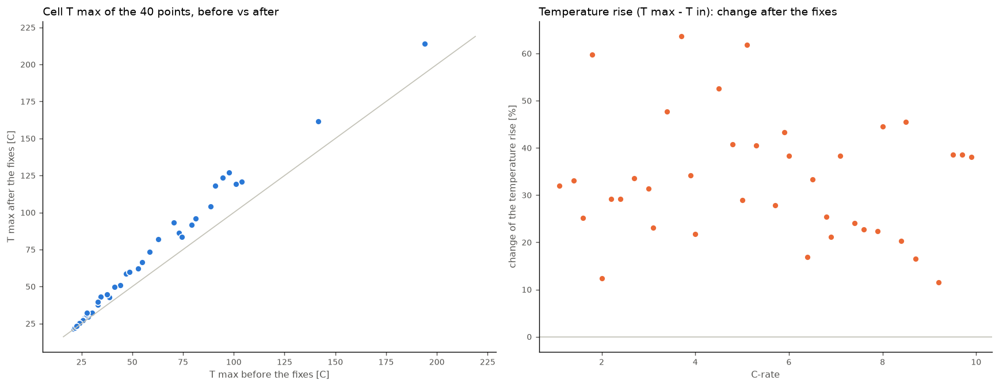
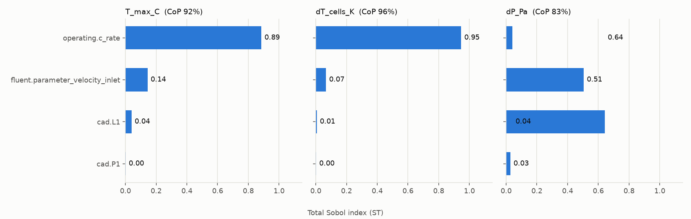
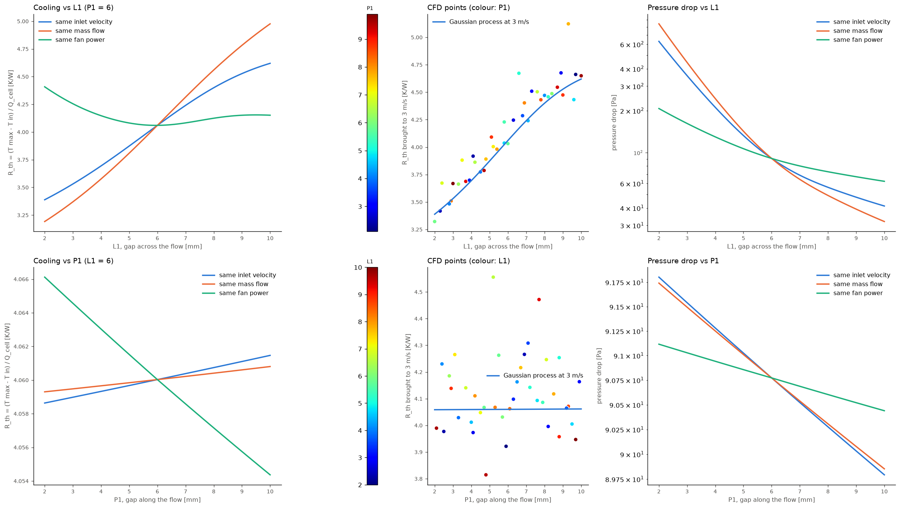
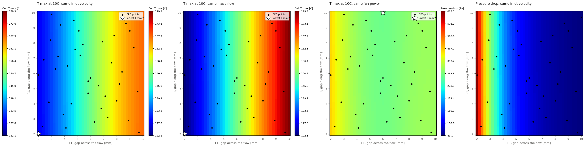
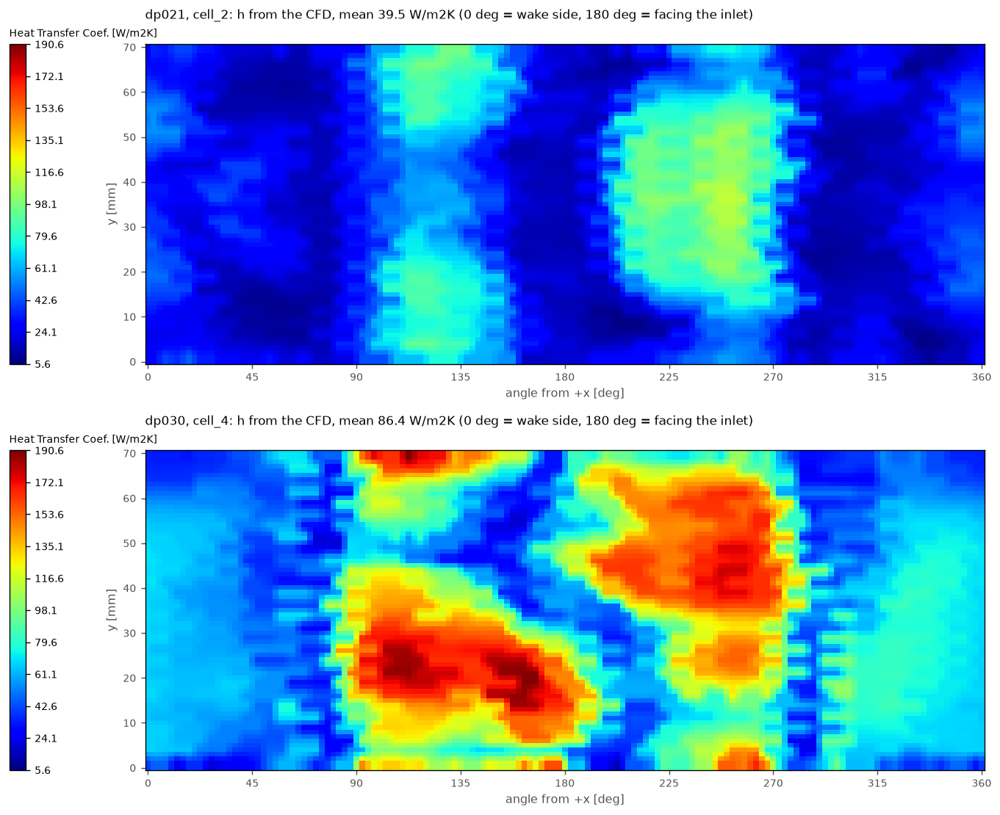
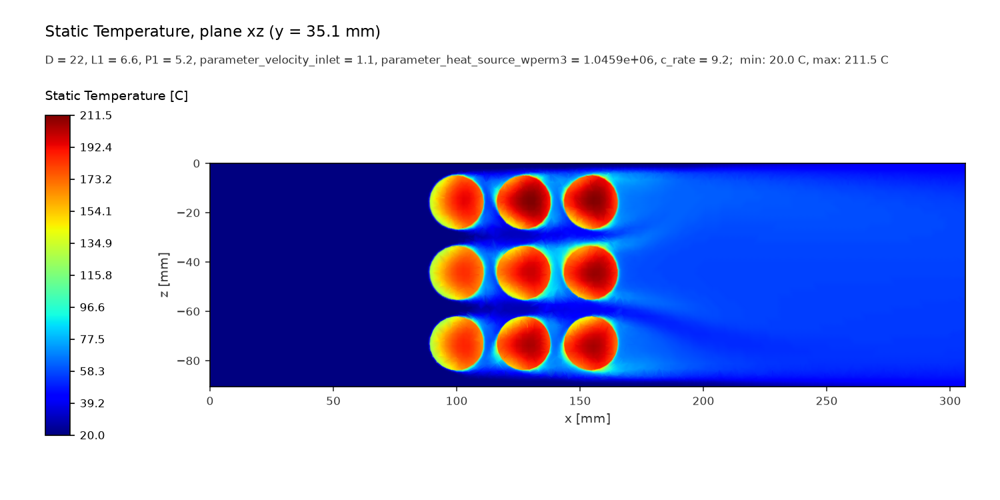
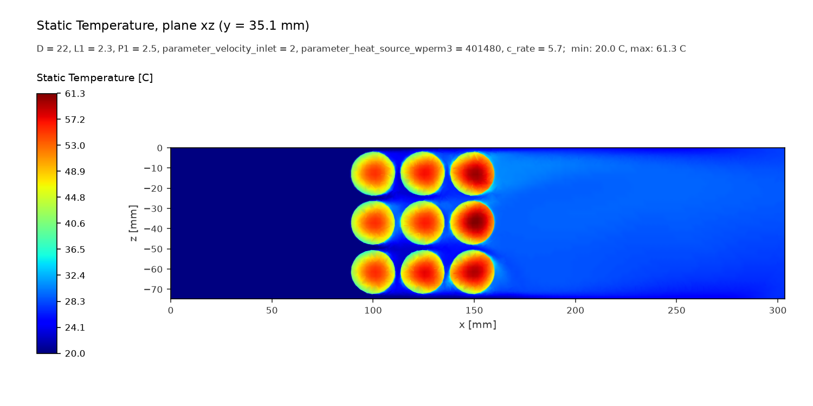
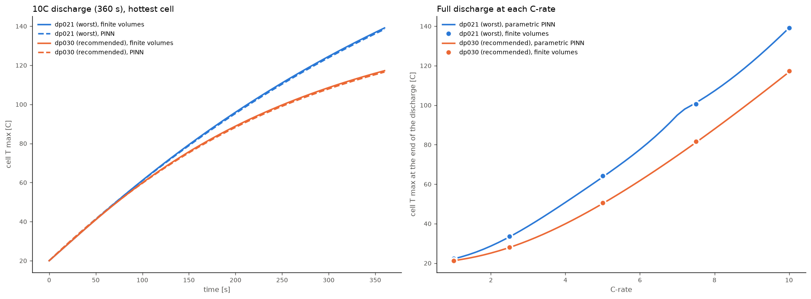
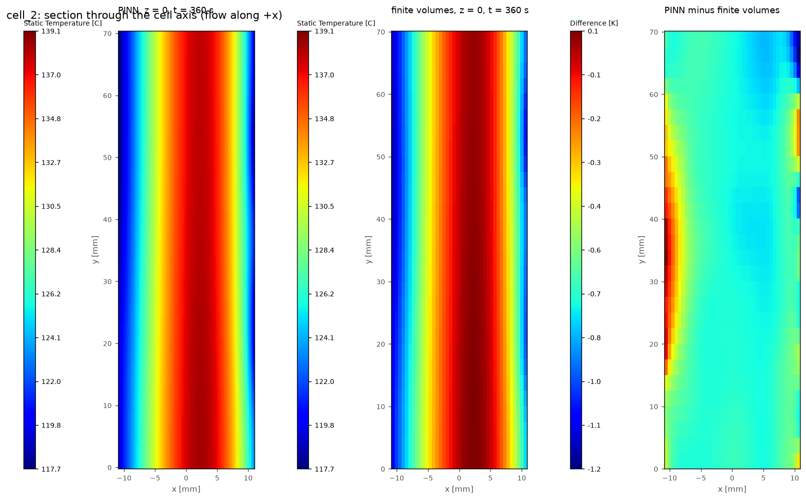

# Relatório final: refrigeração a ar de um módulo de 9 células 21700

Projeto `autocfd` (SolidWorks → SpaceClaim → Fluent Meshing → Fluent → ML / PINN).
Estudo final: `doe_crate_kfix` (40 pontos, outubro de 2026). Figuras em `reports/figures/`,
números em `reports/figures/numbers.json` (gerados por `python reports/make_report_figures.py`).

## Conclusões

1. **A taxa C domina a temperatura** (índice de Sobol total 0,89 no T max; a velocidade do
   ar, 0,14; a geometria, ≤ 0,04). A geometria só aparece quando se elimina a taxa C, usando
   a resistência térmica R_th = (T max − T entrada) / Q por célula.
2. **P1 (folga entre células ao longo do escoamento) não tem efeito** na refrigeração
   (+0,5 % ± 4,2 % em R_th) nem na perda de pressão (−0,9 % ± 25 %): use o menor valor,
   **P1 = 2 mm**, que encurta o módulo.
3. **L1 (folga transversal) decide**, mas a resposta depende da comparação. Na mesma
   velocidade ou vazão, L1 menor resfria muito melhor e custa muito mais ventilador (ΔP de
   629 Pa em L1 = 2 contra 41 Pa em L1 = 10 a 3 m/s). **Na mesma potência de ventilador**
   (a comparação justa) há um ótimo no meio: L1 ≈ 6 mm (149,9 °C a 10C); de 3,4 a 10 mm os
   valores empatam dentro da incerteza do modelo; L1 = 2 mm fica 11 K mais quente.
4. **Geometria recomendada: L1 = 3,4 mm, P1 = 2 mm**, o módulo mais compacto que empata com o
   ótimo (arranjo de células de 356 cm³, contra 425 cm³ em L1 = P1 = 6 e 517 cm³ em 10 mm),
   **desde que o ventilador entregue ~150 Pa a 13 g/s** (mesma potência da referência,
   1,7 W). Se a compacidade não importar, L1 = 6 mm dá a menor temperatura estimada com metade
   da pressão (91 Pa a 22 g/s).
5. **O regime permanente superestima muito a temperatura em taxas altas.** No pior ponto do
   estudo, a 10C o regime permanente daria ~250 °C; numa descarga completa de 360 s a célula
   mais quente chega a **139 °C** (PINN e volumes finitos). No ponto da geometria recomendada,
   **117 °C** (contra ~150 °C em regime permanente).
6. **Os PINNs funcionam** para a temperatura transiente da célula: com o resfriamento extraído
   do CFD, reproduzem os volumes finitos dentro de 0,4 a 0,8 K a 10C e, no modelo paramétrico,
   respondem qualquer taxa de 1 a 10C em milissegundos.
7. **Três correções mudaram os resultados em +33 % (mediana) na subida de temperatura**:
   eixo da condutividade das células, calor real por célula e convergência (seção 2).

## 1. O que foi construído

| etapa | ferramenta | o que faz |
|---|---|---|
| geometria | SolidWorks (COM) | cópia da peça, variáveis globais (D, L1, P1), rebuild; falha se a combinação for inválida |
| preparação | SpaceClaim (batch) | named selections inlet/output pela posição das faces |
| malha | Fluent Meshing | repete o workflow `.wft` salvo; até 3 tentativas (falhas de importação CAD transitórias) |
| solver | Fluent | lê o caso base, troca a malha, aplica as named expressions; convergência por médias de bloco |
| estudo | `study` | LHS de 40 pontos, retomável, `--retry-failed`, para após 3 falhas iguais seguidas |
| pós | `postprocess` | imagens (estilo Fluent), campos para CNN (`.npz`), dados das células para o PINN |
| análise | `analyze`, `train`, `optimize` | Sobol/CoP, processo gaussiano, otimização bayesiana |
| geometria | `geometry-report` | comparação justa das folgas, recomendação, `report.md` |
| transiente | `pinn` | PINN da célula (uma taxa ou paramétrico em C), validado por volumes finitos |

Testes: 58 (sem Ansys), lint ruff limpo.

## 2. Correções e o que elas mudaram

| problema | como foi encontrado | correção |
|---|---|---|
| **k = 25 W/m·K ao longo de z**, mas o eixo das células é y (herdado do projeto P50B) | leitura do material no `.cas.h5`; faixas quentes a ±90° na superfície do PINN | corrigido no caso base: k = 25 em y, 0,8 radial |
| **células 0,32 mm menores na malha** que no CAD (D = 22 → 21,68 mm): 2,9 % menos calor | balanço de calor na parede das células; ajuste de círculo nos nós; CAD conferido no SolidWorks | W/m³ calculado com o volume real da malha (`diameter_offset_mm = -0.32`); calor por célula agora 0,6 % do nominal |
| ponto sem convergir (id 4, 6,8 m/s, no estudo antigo) | `converged = False` | `max_iterations` 500 → 1000: o id 4 converge; agora o id 14 (3,2 m/s, L1 = 8,5) não converge (oscilação de p_in de 0,4 % na esteira) e fica fora da análise |
| 22 pontos falharam na importação CAD (transitório, ~1 h) | transcripts do Fluent Meshing | novas tentativas automáticas, status `mesh_failed`, `--retry-failed` |
| limites de normalização dos campos para CNN estreitos | avisos do export | T 20–230 °C, p −1000–1600 Pa, U 0–50 m/s |



Comparando os 38 pontos convergidos nos dois estudos: a subida de temperatura aumentou entre
11 % e 64 % (mediana +33 %), até +29,5 K num ponto. A maior parte vem do eixo de k: com a
condutividade radial correta (0,8 W/m·K nas duas direções transversais) o calor sai mais
devagar do centro da célula.

## 3. Estudo paramétrico (`doe_crate_kfix`)

| parâmetro | faixa |
|---|---|
| L1, folga transversal | 2 a 10 mm |
| P1, folga ao longo do escoamento | 2 a 10 mm |
| taxa C (5 Ah, R_DC 12,8 mΩ) | 1 a 10 C |
| velocidade de entrada | 1 a 7 m/s |
| fixos | D = 22 mm (21,68 na malha), altura 70,15 mm |

40 pontos, 40 resolvidos, 39 convergidos. T max de 21,4 a 214 °C (regime permanente), ΔP de
10 a 1480 Pa.

| índice de Sobol total S_T | T max | ΔP | ΔT entre células |
|---|---|---|---|
| L1 | 0,04 | **0,64** | 0,01 |
| P1 | 0,00 | 0,03 | 0,00 |
| velocidade | 0,14 | **0,51** | 0,07 |
| taxa C | **0,89** | 0,04 | **0,95** |



## 4. Escolha da geometria

A resistência térmica R_th não depende da taxa C (problema linear no calor), então permite
comparar geometrias. Modelos ajustados nos 39 pontos (validação deixando um ponto de fora):
processo gaussiano R² = 0,996 (R_th) e 0,998 (ΔP); a lei log-linear
R_th ∝ v^−0,43 · e^(0,042·L1) (R² 0,968) serve para ler os efeitos, mas não representa o
ótimo interno descrito abaixo.

L1 também alarga o duto (a largura cresce ~3,45 mm por mm de L1, medida pela vazão), então na
mesma velocidade um L1 maior recebe mais ar. Três comparações, a 10C (32 W por célula),
relativas à referência L1 = P1 = 6 mm a 3 m/s (21,8 g/s, 1,68 W de ventilador):

| L1 | mesma velocidade: T max / ΔP | mesma vazão: T max / ΔP | **mesma potência: T max / ΔP / vazão** |
|---|---|---|---|
| 2 mm | 128 °C / 629 Pa | 122 °C / 841 Pa | **161 °C** / 207 Pa / 9,5 g/s |
| 6 mm | 150 °C / 91 Pa | 150 °C / 91 Pa | **150 °C** / 91 Pa / 21,8 g/s |
| 10 mm | 168 °C / 41 Pa | 179 °C / 32 Pa | **153 °C** / 62 Pa / 31,8 g/s |



**Como ler a figura:** as três curvas se cruzam em L1 = 6 *por construção*: é a referência,
onde velocidade, vazão e potência são iguais às dela. O cruzamento não é um ótimo. Na mesma
velocidade/vazão, L1 pequeno parece muito melhor porque o ventilador gasta muito mais (9,8 W
contra 1,7 W). Na mesma potência (curva verde), a célula tem uma resistência interna em série
com a convecção. Folgas muito pequenas reduzem demais a vazão que o ventilador consegue
empurrar; folgas grandes dão mais vazão, mas (provavelmente) com o ar menos acelerado junto às
células. O resultado é um ótimo no meio (L1 ≈ 6).



**Recomendação** (regra: na mesma potência, valores a menos de 2 K ou 2σ do melhor empatam;
entre eles, o mais compacto):

| parâmetro | valor | motivo |
|---|---|---|
| L1 | **3,4 mm** | ótimo em 6 mm (149,9 °C); 3,4 a 10 mm empatam dentro da incerteza; 3,4 é o mais compacto (154,6 ± 3,6 °C) |
| P1 | **2 mm** | sem efeito significativo → o mais compacto |

Operação da geometria recomendada a 10C:

| se o ventilador mantiver a | v | vazão | ΔP | potência | T max |
|---|---|---|---|---|---|
| mesma potência da referência | 2,04 m/s | 13,3 g/s | 148 Pa | 1,68 W | 154,8 °C |
| mesma velocidade (3 m/s) | 3,00 m/s | 19,6 g/s | 291 Pa | 4,84 W | 134,9 °C |
| mesma vazão (21,8 g/s) | 3,34 m/s | 21,8 g/s | 351 Pa | 6,50 W | 130,3 °C |

Detalhe completo, com tabelas e mapas: `output/studies/doe_crate_kfix/geometry/report.md`.

## 5. Pior ponto × geometria recomendada

| | **dp021** (maior T max do estudo) | **dp030** (mais perto de L1 = P1 = 2) | dp010 (1º caso do PINN) |
|---|---|---|---|
| L1 / P1 | 6,6 / 5,2 mm | 2,3 / 2,5 mm | 5,1 / 8,8 mm |
| velocidade / vazão | **1,1 m/s** / 8,2 g/s | 2,0 m/s / 12,3 g/s | 1,3 m/s / 9,2 g/s |
| taxa C do ponto de CFD | 9,2 C | 5,7 C | 8,7 C |
| T max CFD (regime perm.) | **214 °C** | 62 °C | 162 °C |
| ΔP | 13 Pa | 260 Pa | 27 Pa |
| R_th (independe de C) | **7,16 K/W** | **4,05 K/W** | 5,85 K/W |
| h médio na célula mais quente | 40 W/m²K (5 a 114) | 86 W/m²K (15 a 191) | 51 W/m²K |

A comparação justa entre os dois é por R_th: o dp030 extrai o calor **1,8× melhor**. Ele junta
folgas pequenas (ar acelerado entre as células) e o dobro da velocidade; o dp021 tem a menor
velocidade do estudo. Note que o dp030 paga isso em pressão (260 contra 13 Pa).



CFD em regime permanente (plano xz a meia altura), dp021 e dp030:




### Descarga transiente (PINN, mesma taxa C nos dois)



| descarga completa | dp021, célula mais quente | dp030, célula mais quente | diferença |
|---|---|---|---|
| 1C (3600 s) | 22,3 °C | 21,3 °C | 1,0 K |
| 5C (720 s) | 64,3 °C | 50,5 °C | 13,8 K |
| 10C (360 s) | **139,1 °C** | **117,2 °C** | 21,9 K |
| 10C em regime permanente (R_th × 32 W) | ~249 °C | ~150 °C | 99 K |

Em 6 minutos a 10C a massa térmica da célula domina: a diferença de refrigeração (1,8×)
vira 22 K, não os 99 K do regime permanente. Para ciclos longos ou taxas moderadas mantidas,
a refrigeração pesa mais.

## 6. Modelo transiente da célula (PINN)

Equação resolvida em uma célula: condução ortotrópica (k = 25 axial, 0,8 radial), calor
(C·Ah)²·R_DC uniforme, resfriamento lateral com o mapa h(θ, y) do CFD, extremidades adiabáticas.
O PINN é treinado só com os resíduos (sem dados de simulação) e conferido de duas formas:

| verificação | dp021 | dp030 | dp010 |
|---|---|---|---|
| modelo reduzido em regime permanente × CFD (T max, 9 células) | −1,4 a +1,0 K (até 214 °C) | ±0,25 K | ±0,9 K |
| PINN de uma taxa (10C) × volumes finitos, T max no fim | 138,5 × 139,1 °C | 116,6 × 117,2 °C | 131,5 × 132,2 °C |
| PINN paramétrico (1 a 10C), erro máx. do T max | ≤ 0,71 K | ≤ 0,55 K | ≤ 0,56 K até 7,5C; 2,4 K a 10C |

O que foi necessário para chegar aí:
- adimensionalização por número de Fourier em cada direção e condição inicial exata;
- **pesos adaptativos com limite**: sem limite, o peso de um termo já satisfeito explodiu
  (5×10⁷) e o PINN errou 43 K; com limite de 1000× o erro caiu para < 1 K;
- **margem na faixa de C**: treinar exatamente em [1, 10] deixava 5,6 K de erro a 10C (borda);
  treinando em [0,55; 10,45], 0,4 K (dp021) a 2,4 K (dp010).

Limitação: a curva paramétrica do dp021 tem uma pequena inflexão perto de 7C (visível no
gráfico), entre pontos de validação que estão corretos; para uso fino, valide pontos novos
contra os volumes finitos (`autocfd pinn` gera os dois).



## 7. Dados para Machine Learning

Para cada ponto e plano central (xy, yz, xz): `.npz` com T, p, U em float32 numa grade fixa
(256 × 64 × 128), normalização global, máscara de fluido, SDF e vetor de parâmetros
(`output/studies/doe_crate_kfix/ml_fields/`). 40 casos × 3 planos, prontos para uma U-Net
(`autocfd.ml_fields.load_dataset`). Com 39 casos convergidos, o conjunto é pequeno para uma CNN:
use-o para testar a arquitetura ou aumente o DOE.

## 8. Limitações

- Regime permanente no CFD (o transiente só existe no nível da célula, via PINN), com o ar
  respondendo quase estaticamente e o mapa h válido para qualquer taxa (propriedades constantes).
- Células com calor uniforme e R_DC constante (sem dependência de SOC e temperatura).
- Malha: células 0,32 mm menores que o CAD, por causa do facetamento na importação. O calor foi
  corrigido, mas as folgas reais são ~0,3 mm maiores que L1 e P1. Corrigir o facetamento no
  `.wft` e remalhar seria o próximo passo de precisão.
- A recomendação depende do ventilador: confira a curva dele (pressão estática na vazão da tabela).
- 1 ponto de 40 (id 14) não convergiu em 1000 iterações (oscilação na esteira); a restrição de
  otimização `dP_Pa <= 25` no config não corresponde à faixa do estudo (ΔP de 10 a 1480 Pa).

## 9. Como reproduzir

```powershell
python -m autocfd study                         # 40 pontos (retomável; --retry-failed)
python -m autocfd analyze
python -m autocfd train
python -m autocfd geometry-report               # recomendação de geometria
python -m autocfd --set pinn.point=dp021 pinn
python -m autocfd --set pinn.point=dp021 pinn --parametric
python -m autocfd --set pinn.point=dp030 pinn
python -m autocfd --set pinn.point=dp030 pinn --parametric
python reports/make_report_figures.py           # figuras e números deste relatório
```
